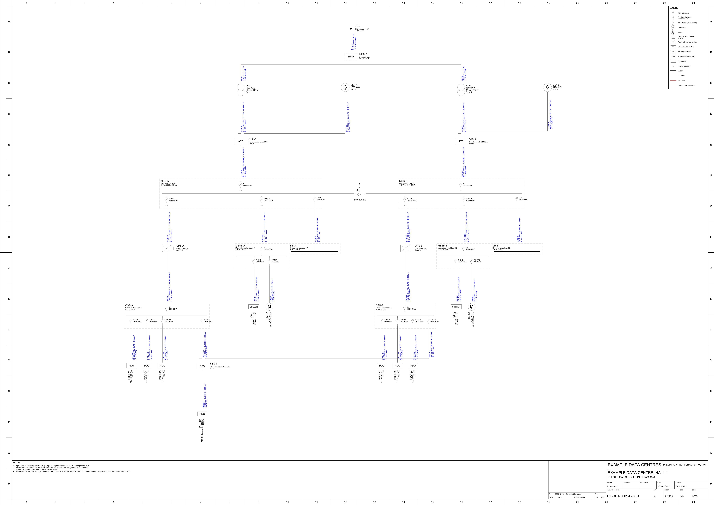
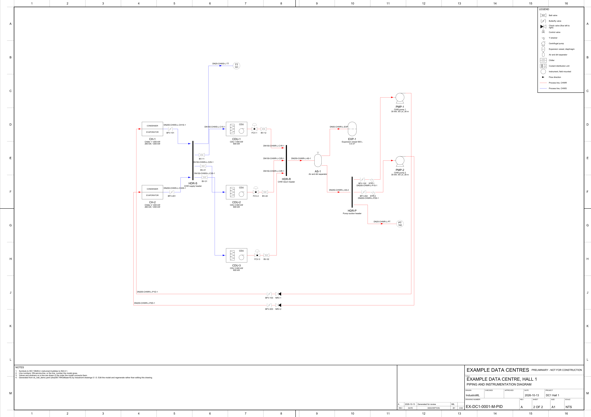

# Drawings

Formal electrical single line diagrams and P&IDs, generated from an
IndustroML model as DXF for CAD, PDF to issue, and PNG to review.

```bash
pip install -r requirements.txt            # ezdxf and matplotlib
python3 -m drawings examples/models/dc_hall_demo.yaml --out out/
python3 -m drawings MODEL --sld            # only the SLD
python3 -m drawings MODEL --pid --no-plot  # only the P&ID, DXF only
python3 -m drawings MODEL --flat           # plain DXF for FreeCAD
python3 -m drawings MODEL --sheet A3       # every sheet A3, scaled to fit
```

<p align="center">
  
</p>
<p align="center">
  
</p>

The examples are in `examples/outputs/drawings/`. The data hall is invented
(`examples/tools/make_dc_demo.py` writes it).

## What is on a sheet

- **Sheet.** The smallest of A3, A2, A1 or A0 landscape the diagram fits at
  full size. ISO 5457 border with a filing margin and lettered and numbered
  zones. A diagram too big for A0 is scaled to fit and the scale box says so.
- **Title block.** Bottom right, filled from the model's `meta.drawing`
  (client, project, number, drawn, checked, approved, status) and
  `meta.revisions`. Missing fields stay blank. Nothing is invented.
- **Revision table, notes and legend.** The legend lists only the symbols
  and line styles that sheet uses. The last note names the model file and
  its SHA-256, so a sheet can be traced back to the model that made it.

## Sheets in a set

A drawing that won't fit one sheet at a readable size is split, the way a
drafter would split it. Sheets are numbered across the set (`3 OF 10`), and
the drawing number takes a sheet suffix (`-03`).

- **SLD.** A *final board* is one whose circuits all end at loads. Each
  final board gets its own sheet, and its supplies arrive at off-sheet
  connectors ("FROM MSB-A F-MECH, SHEET 1"). Everything above the final
  boards goes on an overall sheet, with "OUTGOING CIRCUITS: SEE SHEET n"
  under each final board's busbar. If the overall sheet would still print
  below 0.6 scale, each main board (one fed straight from a transformer or
  generator) gets a sheet of its own, with its supplies, its busway or load
  feeders, and onward connectors ("TO MSSB-A IN, SHEET 5") to boards on
  other sheets. By default the SLD splits when a single sheet would need
  A0; `--split always|never` overrides that.
- **P&ID.** Separate systems (two independent CHW loops, say) are drawn in
  their own bands. With `--sheet`, if the combined sheet would print below
  0.6 scale, each system gets a sheet, named after its plant ("SYSTEM CH-1,
  CH-2").

## SLD

Symbols follow IEC 60617 (AS/NZS 1102). Supply is at the top and load at the
bottom; one line is a three-phase circuit.

| In the model | On the drawing |
|---|---|
| switchboard, mcc, distribution_board, panelboard | Busbar in a dashed enclosure, tag and rating at top left |
| A board interface with `device` (acb, cb, mccb, mcb, fuse, switch_fuse, isolator) or a current rating | That protective device on the feeder at the busbar, labelled with rating, poles and kA |
| breaker, fuse, isolator, CT or meter with one cable in and one out | Drawn inline on the feeder |
| transformer, generator, UPS, VSD, ATS, STS, RMU, PDU, motor | Its symbol, with tag, rating and voltage |
| Any other asset fed by a cable (chiller, CDU) | A labelled equipment box |
| A cable | A line, with id, construction (runs, cores, size, conductor, insulation, earth), length and method written beside it |
| A cable over 1 kV, or on an `ac_hv_3ph` interface | The HV layer, in red |
| A node fed from two places (ATS, STS, dual-input UPS) | Drawn under its nearest supply; the other feed is routed across to a second input |
| A generator that only feeds an ATS | Drawn beside the transformer, a level above the ATS |
| A cable between two boards that each have a supply, `tie: true`, or a port named `TIE` | A bus tie between the busbars |

## P&ID

Symbols follow ISO 10628-2 and instrument bubbles follow ISA-5.1. Flow runs
left to right.

| In the model | On the drawing |
|---|---|
| pump, chiller, CDU, tank, expansion vessel, air separator, heat exchanger, dry cooler | Its symbol, in columns in the order of flow |
| header | A heavy vertical bar, inlets on the left and outlets on the right |
| valve (`valve_type`: gate, globe, ball, butterfly, check, control), strainer, filter, orifice plate, with one pipe in and one out | Drawn inline on the line, in the order the model connects them, tagged below |
| A transmitter on the end of a pipe | An ISA bubble on a tapping line, with letters and loop number from its tag (`TT-101` → TT 101) |
| A pipe | A line with a flow arrow and a line number, `DN-service-id` or the connection's `line_number` |
| `service` (CHWS, CHWR, …) | A layer per service, `P-LINE-CHWS`, coloured so supply and return can be followed |
| A closed loop | Cut where it returns to the chillers (or tanks or dry coolers), with the return drawn along the bottom |

## The DXF

- **Format.** AutoCAD 2013 (AC1027), millimetres, drawn full size in model
  space. It plots 1:1 on the named sheet.
- **Symbols.** Blocks with attributes (`TAG`, `RATING`, `VOLTS`, `FUNC`,
  `LOOP`), so a value can be edited in CAD without exploding anything.
- **Layers.** Each layer carries colour, linetype and lineweight: `E-HV`,
  `E-LV`, `E-BUSBAR`, `E-ENCL`, `E-DEVICE`, `E-CABLE-TEXT`, `P-EQUIP`,
  `P-VALVE`, `P-LINE-<SERVICE>`, `P-LINE-TEXT`, `SHEET-*`.
- **`--flat`.** Explodes every symbol into plain lines and text. FreeCAD's
  DXF importer drops block attributes and text inside blocks; with `--flat`
  it imports cleanly.

## Limits

- **Layout.** Automatic and reasonable, but no drafter. Cable text is placed
  beside its line without collision checks. P&ID line numbers avoid
  symbols, labels and headers, but on a crowded sheet one can still touch a
  line.
- **Missing from the model.** Port positions on equipment and protection
  settings, so neither is drawn.
- **Control.** Control loops beyond a bubble's tag (signal lines to the
  controller) aren't drawn yet.
